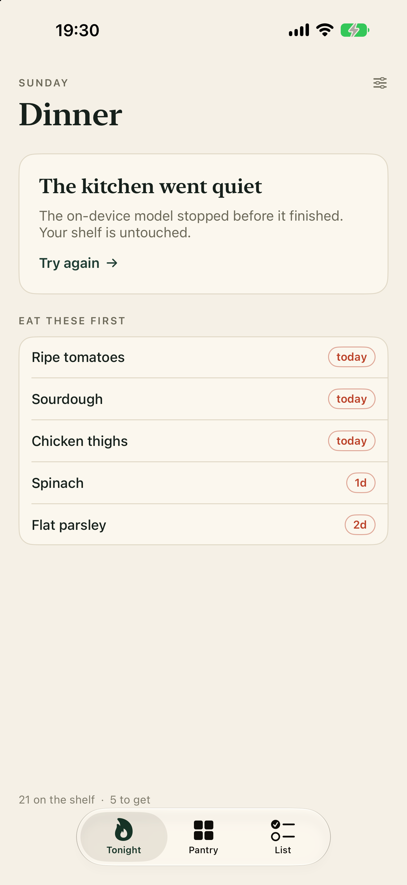

# Larder

A pantry and dinner app for iPhone and Mac. Scan what you have, get dinner from it, and keep a
shopping list that is already on the other device.



## The pain it removes

It is seven in the evening. The fridge is full and you still cannot answer the only question that
matters, so you order something and the spinach goes brown. Meanwhile you buy a third jar of cumin
because you cannot see the one at the back.

Larder keeps the shelf instead of you. It notices what is about to go off, names one dinner you can
cook tonight, and puts only the genuinely missing things on a list that is open on your Mac.

## What is in it

- **Scan the shelf.** Live barcode scanning on iPhone (`DataScannerViewController`). The first scan of
  a product asks for a name once; after that the barcode is remembered in SwiftData and every later
  scan lands in one tap with no network. A label photo goes through Vision, then the on-device model
  sorts the words into rows and aisles. On Mac the same pipeline runs from a dropped photo or a
  receipt screenshot.
- **Dinner from what you have.** `FoundationModels`. A `@Generable` `DinnerIdea` carries the dish, the
  reason, the minutes, the ingredients already home, the missing few and the method. The title streams
  in as it is written, so the screen is alive immediately.
- **A list that syncs.** SwiftData with a private CloudKit mirror, one store shared with the widget
  through an app group. Check milk off on the phone and it is gone on the Mac.
- **Words, not forms.** "2 cans chickpeas, parsley, a lemon" becomes three rows with the right aisles
  and quantities, because the parsing is a model call, not a regex.
- **App Intents.** "What is for dinner in Larder", add to the list, stock the pantry, all from Siri or
  Shortcuts, with `AppShortcutsProvider` phrases.
- **A widget.** Shelf count, what needs eating, and the open list, on the Home Screen and the Lock
  Screen.

## Architecture

```
Shared/            Models, the CloudKit container decision, the palette
Larder/
  Views/           Tonight, Pantry, List, add and edit sheets, settings
  Intelligence/    DinnerIdea and ParsedBasket schemas, the actor that runs the session
  Scan/            Vision reader, live barcode scanner, Mac shelf drop
  Intents/         App Intents and shortcut phrases
Widgets/           WidgetKit bundle reading the same store read only
```

`project.yml` is the source of truth for the Xcode project, generated with
[XcodeGen](https://github.com/yonaskolb/XcodeGen). One SwiftUI multiplatform target plus one widget
extension, iOS 26 and macOS 26, Swift 6 with complete concurrency checking.

CloudKit mirroring needs the iCloud entitlement, which only a signed build carries. That decision is
made once, explicitly, in `Store.mirrors`: Core Data's mirroring setup raises inside CloudKit on a
background queue when the entitlement is absent, so there is no error to catch.

## Build

```
~/.pi/agent/bin/xcodegen generate
xcodebuild -project Larder.xcodeproj -scheme Larder -destination 'platform=iOS Simulator,name=iPhone 18 Pro' build
xcodebuild -project Larder.xcodeproj -scheme Larder -destination 'platform=macOS' build
```

Archive and export for the App Store (team Fornace s.r.l., 2V6YSU4HFB):

```
xcodebuild -project Larder.xcodeproj -scheme Larder -configuration Release \
  -destination 'generic/platform=iOS' -archivePath build/Larder.xcarchive \
  -derivedDataPath build/dd-archive -allowProvisioningUpdates archive

xcodebuild -exportArchive -archivePath build/Larder.xcarchive -exportPath build/export \
  -exportOptionsPlist scripts/ExportOptions.plist -allowProvisioningUpdates
```

## App Store

The record exists: **Larder: Pantry and Dinner**, App Store Connect ID `6824195346`, bundle
`app.fornace.larder`, iOS and macOS on one multiplatform record.

The exported build is store-signed: `build/export/Larder.ipa`, authority
`Apple Distribution: Fornace s.r.l. (2V6YSU4HFB)`, iOS Team Store Provisioning Profile valid to
14 September 2027.

The upload needs one file that is not on this Mac: the App Store Connect API private key
`AuthKey_K6R4NZ46Z5.p8`. The key is live in the portal (Admin, generated 25 June 2026), but Apple
lets you download a `.p8` only once, and its recorded fingerprint matches no file on disk. Xcode
cannot stand in, because this Mac has no Apple Account configured and an upload export fails with
*Failed to Use Accounts*.

Once the key sits at the path named in `~/.agent_credentials/apple/appstore-connect.env`:

```
./scripts/upload.sh
```

It reads that env file, signs `asc` in and runs
`asc builds upload --app 6824195346 --ipa build/export/Larder.ipa --wait`.

## Design

Warm bone and ink, one flat colour per surface, no gradients. New York for display, SF for text,
rounded figures for counts. Every screen names the shelf in the user's own words rather than the
app's.

## Status

Built, signed, exported, and the App Store record is created. The dinner generation is wired against
the iOS 27 Foundation Models API and compiles for both platforms, but this Mac's Apple Intelligence
model assets are not installed (`ModelManagerError 1001` under every guardrail and use case), so a
generated dinner has not been observed running here. Everything else on this page was exercised on
the simulator and the Mac.
